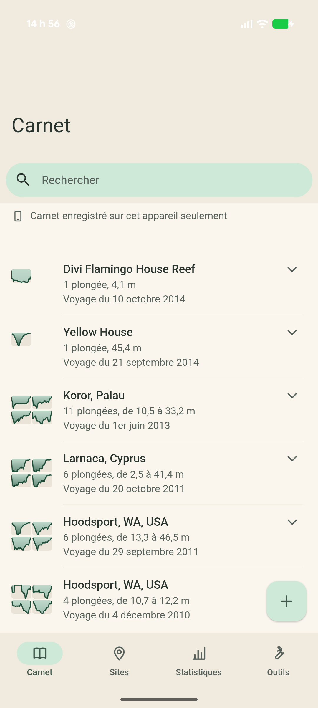
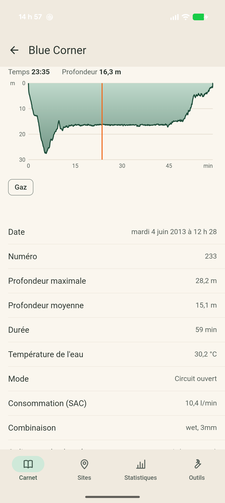

# Squelette d'application Android

**But :** vérifier que l'application tourne sur un vrai téléphone et affiche des plongées lues par le cœur C++ de Subsurface, non modifié, au format git. Ce n'est pas l'interface finale.

**Résultat (5 novembre 2026) :** le critère est atteint sur un Pixel 10 Pro XL sous Android 17. Les 29 plongées de `SampleDivesV2.ssrf` s'affichent, et un second lancement les relit depuis git.

## Ce qui marche

- **Application :** Capacitor 7, Svelte 5, Framework7 v9 et Vite, en JavaScript avec JSDoc. Le thème automatique donne le rendu Material sur Android. Un seul écran : le carnet, regroupé par voyage.
- **Cœur :** les 69 fichiers du POC, compilés pour `arm64-v8a` et `x86_64`. Le sous-module Subsurface n'a aucune modification.
- **Plugin `OpenDivesCore` (Kotlin + JNI) :**
  - `importSample()` enregistre l'exemple comme dépôt git avec `parse_file` puis `save_dives("<chemin>[main]")`.
  - `listDives()` relit ce dépôt avec `parse_file` et renvoie le JSON.
  - Le cœur tourne sur un seul fil dédié.

## Vérifications faites

| Vérification | Résultat |
| --- | --- |
| Premier lancement (journal du téléphone) | Dépôt absent, 29 plongées enregistrées, puis 29 relues |
| Second lancement après arrêt forcé | Dépôt présent, 29 plongées relues, sans import |
| Dépôt copié du téléphone vers le poste | `git fsck` sans erreur ; 1 commit |
| Comparaison avec le même import fait sur le poste | Arbre git identique (`9ed06c7`) |
| Lecture de la copie par le programme du POC | 29 plongées, 16 sites, 4 voyages ; export XML identique à celui du poste |
| Test d'aller-retour sous WSL (poste) | 97 réussis, 1 échec connu (`TestDiveSeabearNewFormat.xml`) |

L'application `x86_64` a été compilée et embarquée, mais pas lancée sur un émulateur.

## Tailles

| Élément | Taille |
| --- | --- |
| APK de débogage, deux architectures | 12,9 Mo (12 949 731 octets) |
| APK de débogage, `arm64-v8a` seule | 8,8 Mo (8 808 203 octets) |
| `libopendives.so`, `arm64-v8a` | 4,1 Mo (4 103 240 octets) |
| `libopendives.so`, `x86_64` | 4,1 Mo (4 137 944 octets) |
| JavaScript, puis CSS (non compressés) | 897 Ko, puis 505 Ko |
| Carnet d'exemple embarqué (non compressé) | 1,7 Mo |

Les bibliothèques contiennent déjà toutes les dépendances, sauf la zlib du système. Aucun APK de publication n'a été produit : il sera plus petit.

## Problèmes rencontrés

- **libgit2 et le NDK :** libgit2 impose `-std=c90`, où les en-têtes du NDK ne connaissent pas `inline`. Corrigé par `-Dinline=__inline__` dans `native/build-deps.sh`, sans toucher à ses sources.
- **Vite et le plugin local :** le plugin étant un lien vers `../plugins`, Vite ne trouvait pas `@capacitor/core`. Corrigé par `resolve.dedupe`.
- **Java :** Android Studio 2026.2 embarque Java 25. Les compilations sont lancées avec un JDK 21, comme Capacitor 7 le demande. Dans Android Studio, il faut choisir ce JDK comme « Gradle JDK ».
- **Compilation en deux temps :** libdivecomputer utilise autotools. Le natif se compile donc sous WSL et l'APK sous Windows. Gradle ne recompile pas le natif : relancez `native/build-android.sh` si le C++ change.
- **API minimale :** elle passe de 23 (valeur de Capacitor) à 24, celle du natif.

## À savoir pour la suite

- **Signature des commits :** les commits sont signés « Subsurface », le comportement par défaut du cœur, alors que l'architecture prévoit « OpenDives ». Rien n'est encore réglé pour cela.
- **Message d'erreur à l'enregistrement :** le cœur écrit `origin lookup failed` pour un dépôt sans distant, et l'enregistrement réussit quand même. Le mode local devra éviter d'afficher ce message.
- **Branche `HEAD` :** `git_create_local_repo` laisse `HEAD` sur `master`, sans commit, alors que les données sont sur `main`. C'est le code de Subsurface, et le cœur lit bien `main`.
- **Voyages à l'écran :** le fichier en déclare 4, mais il active aussi le regroupement automatique. `listDives` en renvoie donc 6, à 5 noms différents, car deux plongées isolées forment chacune un voyage automatique. Le lieu « Hoodsport » apparaît deux fois, car ce sont deux voyages distincts.
- **Identifiants de voyage :** ils changent à chaque chargement et ne doivent pas être conservés.
- **Écran :** l'heure et les icônes de la barre d'état, en blanc, sont peu lisibles sur le fond clair. Les valeurs s'écrivent « 4.1 m », pas « 4,1 m ». À reprendre avec la vraie interface.
- **Identifiant de l'application :** `org.opendives.app` est provisoire, à confirmer avant toute publication.
- **Hors de ce squelette :** iOS, téléchargement depuis un ordinateur de plongée, modification des plongées, envoi vers le cloud.

## Cloud Subsurface en lecture seule (5 novembre 2026)

**Résultat :** sur le même téléphone, l'app lit le carnet d'un compte de développement : 1 353 plongées, sur `ssrf-cloud-eu.subsurface-divelog.org`.

| Situation | Résultat |
| --- | --- |
| Premier lancement : clone par le cœur | 1 353 plongées affichées ; 3,7 s dans le natif, de la sonde jusqu'au JSON |
| Lancements suivants : mise à jour du cache | 1 353 plongées, `synced=true`, de 4,0 à 5,4 s |
| Erreur réseau passagère (« Software caused connection abort ») | Avant la correction : échec. Depuis : lecture de la copie locale |
| Hors ligne avec cache (sur le poste, sans réseau) | 1 353 plongées, `synced=false`, raison affichée |
| Hors ligne sans cache (sur le poste) | Erreur claire, rien n'est créé |
| Cache du téléphone et serveur, avant et après | Même tête, `89a1e6a` : rien n'a été poussé |

**Comment ça marche :**

- **Réseau :**
  - libgit2 est compilé avec HTTPS par OpenSSL 3.4.4, la version que Subsurface utilise sur Android.
  - La vérification du serveur (`canReachCloudServer`) reprend `https_openssl.cpp`, déjà testé sous Linux.
- **Certificats :** Android ne fournit pas de fichier de certificats lisible par OpenSSL.
  - Au lancement, le plugin exporte en PEM les autorités de confiance du système (`AndroidCAStore`), soit 120 sur ce téléphone.
  - Ce fichier est remis à libgit2 et à la vérification du serveur.
- **Façade :** `cloud_list_dives()` enchaîne les étapes suivantes.
  1. Sonde de la branche en lecture seule. Si la branche est absente du serveur, la façade refuse de charger, car le cœur la créerait en poussant.
  2. Chargement par le cœur.
  3. Recopie des réglages du carnet (`apply_log_prefs`).
  4. Production du JSON.
  - Si le serveur ne répond pas, la façade lit la copie locale avec `git_local_only`, comme Subsurface hors ligne.
- **Écritures :** l'app n'enregistre jamais dans le cache du cloud. Rien ne peut donc être poussé.

**Identifiants : solution TEMPORAIRE de développement.** Le plugin lit `files/cloud-dev.env`, dans l'espace privé de l'app. Ce fichier n'est ni dans l'APK ni dans git, et le mot de passe n'est jamais journalisé. Sans ce fichier, l'app revient au carnet d'exemple. Le vrai écran de connexion, avec le trousseau Android, reste à faire.

```powershell
$adb = "$env:LOCALAPPDATA\Android\Sdk\platform-tools\adb.exe"
# installer (le fichier est lu sur le poste, jamais affiché)
Get-Content -Raw "$env:USERPROFILE\.opendives\cloud-dev.env" | & $adb shell "run-as org.opendives.app sh -c 'umask 077; cat > files/cloud-dev.env'"
# retirer
& $adb shell "run-as org.opendives.app rm files/cloud-dev.env"
```

**Écarts avec l'architecture :** la vérification du serveur utilise OpenSSL dans le natif plutôt que la pile réseau d'Android. Elle ne suit donc pas le proxy du système, ce qui est à revoir avec l'écran de connexion. La liste de 1 353 plongées est affichée d'un bloc, sans liste virtuelle.

## Carnet et Détail d'une plongée (5 novembre 2026)

Premiers vrais écrans, suivant `docs/specification-interface.md`, vérifiés sur le Pixel 10 Pro XL avec le carnet d'exemple et le carnet du cloud (1 353 plongées, en lecture seule).

| Carnet (carnet d'exemple) | Détail, curseur posé |
| --- | --- |
|  |  |

Les captures viennent du carnet d'exemple de Subsurface, jamais d'un carnet personnel.

**Ce qui marche :**

- **Façade :**
  - `list_dives` donne pour chaque plongée un identifiant, une miniature d'environ 40 points (temps et profondeur) et le voyage.
  - `get_dive` renvoie les faits, les bouteilles et les gaz, les changements de gaz, les compagnons, la combinaison, les étiquettes, les notes et l'ordinateur. Le profil est calculé par le cœur (`create_plot_info_new`), avec la bouteille respirée, la ppO2 et le plafond s'il existe.
  - `get_prefs` donne les unités du carnet, une par mesure.
- **Thème :**
  - Les jetons `--od-*` sont déclarés, en clair et en sombre.
  - `colors.primary` vaut `#1E4D3A`, avec les fonds crème en clair.
  - Le CSS est rangé en couches : `framework7`, `od.jetons`, `od.base`, `od.composants`.
  - Les surcharges `--f7-*` restent hors couche, sinon les couleurs que Framework7 injecte au démarrage les écraseraient. Elles ont été vérifiées dans la WebView : primary vaut #1e4d3a en clair et #8fcfae en sombre.
- **Composants :** `<Miniature>`, `<LignePlongee>`, `<LigneVoyage>`, `<Profil>` (colonne d'eau, curseur au doigt, couche Gaz) et `<EtatSynchro>`, plus des icônes dessinées pour le projet.
- **Carnet :**
  - Liste du plus récent au plus ancien, voyages repliés que l'on déplie d'un toucher.
  - Recherche sur le site, le voyage, le numéro ou la date.
  - État de synchronisation : cloud, hors ligne ou appareil seulement.
  - Bouton « + » ouvrant les trois choix, sans action pour l'instant.
  - Lignes grisées pendant le chargement ; états vide et erreur.
- **Détail :**
  - Profil, faits, bouteilles et gaz.
  - Compagnons et étiquettes en deux blocs séparés, puis notes.
  - « Planifier à partir de cette plongée » en mandarine, sans action pour l'instant.
- **Navigation :**
  - Barre du bas avec quatre sections ; Sites, Statistiques et Outils sont vides.
  - La touche Retour d'Android ferme une feuille, revient à l'écran précédent ou au Carnet, puis met l'app en arrière-plan (plugin `@capacitor/app`, MIT).
- **Nombres et unités :**
  - Le format suit la langue de l'appareil : « 4,1 m », « 11,5 l/min », « 1er juin 2013 ».
  - Chaque mesure suit le réglage du carnet : pieds et °C dans le carnet du cloud, mètres dans le carnet d'exemple.
  - Une profondeur inconnue (0) n'est pas affichée.

**Vérifications faites sur le téléphone :**

| Vérification | Résultat |
| --- | --- |
| Clair | Conforme |
| Sombre | Surfaces du système et sapin sombre conformes. **Colonne d'eau et tracé : voir « À trancher »** |
| Texte à 200 % | Le texte grandit sans se superposer. Coupés : l'étiquette « Statistiq… » de la barre du bas, et les graduations du profil, qui restent petites |
| TalkBack (arbre d'accessibilité relevé avec uiautomator) | Chaque ligne est lue « site, date, profondeur maximale, durée ». Profil et miniatures ont un texte de remplacement, la puce Gaz est un bouton à bascule, « + » et Retour ont un nom, et aucun nom d'icône n'est lu. TalkBack lui-même n'a pas été activé |
| Carnet d'exemple, carnet du cloud | Les deux s'affichent, avec leurs unités respectives |

**Problèmes rencontrés et corrigés :**

- **Icônes de Framework7 lues à voix haute :** ce sont des ligatures de police insérées par CSS, et TalkBack lisait « chevron_right ». Elles reçoivent maintenant un texte de remplacement vide (`content: … / ''`).
- **Composant `Fab` de framework7-svelte 9 :** il appelle `onclick` deux fois et laisse le lien sans nom. Le bouton « + » est donc écrit à la main.
- **Page précédente encore lisible :** Framework7 garde la page précédente dans le document, et TalkBack pouvait y aller. Elle reçoit maintenant `inert`.
- **Lien de retour :** en MD3, Framework7 masque son texte, et il était lu « # ». Il est remplacé par un lien nommé « Retour au carnet ».
- **Touche Retour d'Android :** elle fermait l'application. Elle est maintenant reliée au routeur.
- **Erreur passagère de Capacitor :** « Cannot read properties of undefined (reading 'triggerEvent') » apparaît une fois, au premier lancement après une réinstallation. Elle vient de Capacitor, pas d'OpenDives.

**À trancher (spécification) :**

- **Colonne d'eau en sombre :** en sombre, `--od-sapin` (#8FCFAE) et `--od-sapin-clair` (#BFD9CB) sont deux verts clairs.
  - Le dégradé ne code presque plus la profondeur : une plongée à 91 pieds ressemble à une plongée à 48 pieds.
  - Le tracé `--od-trace-profil` (#EAF5EF) sur ce fond a un contraste d'environ 1,3:1 à 1,6:1, sous le 3:1 attendu pour un graphique.
  - Le fond des miniatures disparaît sur la surface sombre.
- **Étiquettes de la barre du bas :** à la plus grande taille de texte, « Statistiques » est coupé.
- **Déjà ouverts dans la spécification :** couleurs Alarme et Attente en sombre (les valeurs claires sont gardées en attendant), distinction de l'oxygène et du sapin.

**Ce qui manque :**

- Couches Plafond, ppO2 et Tissus ; profil plein écran en paysage.
- Mise en page tablette.
- Rendu iOS, qui n'a pas pu être vu.
- Actions du bouton « + » et du planificateur.
- Liste virtuelle : les 1 353 plongées sont dessinées d'un bloc.
- `svelte-check` dans l'intégration continue : un `jsconfig.json` est ajouté pour l'éditeur, mais celui-ci signale encore des erreurs de typage dans les composants de framework7-svelte.

**Tailles :** APK de débogage de 27,7 Mo (deux architectures). `libopendives.so` fait 9,3 Mo en arm64 et 9,6 Mo en x86_64, OpenSSL compris.

## Reproduire

Les commandes sont dans [AGENTS.md](../AGENTS.md#commandes).
